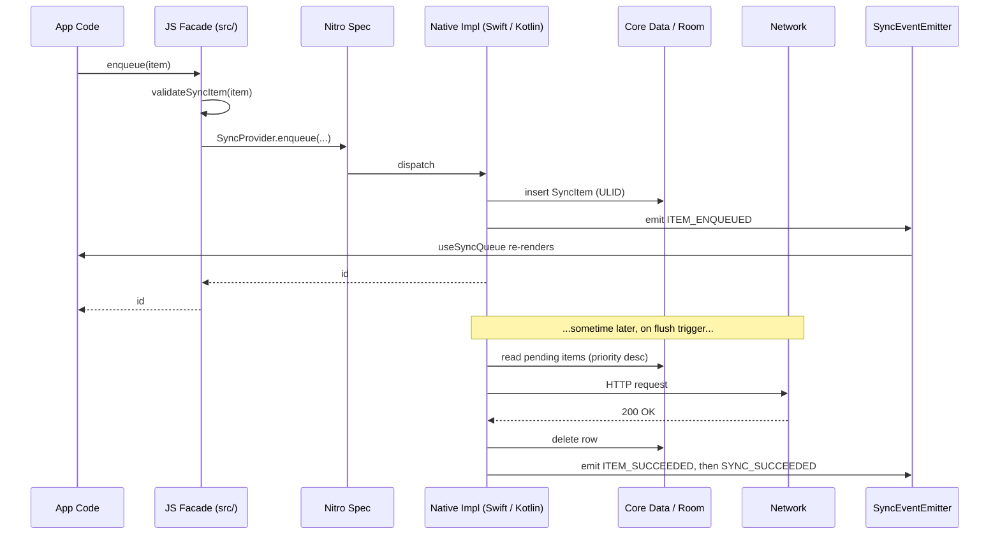
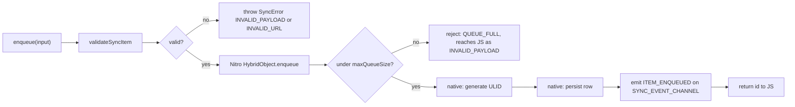
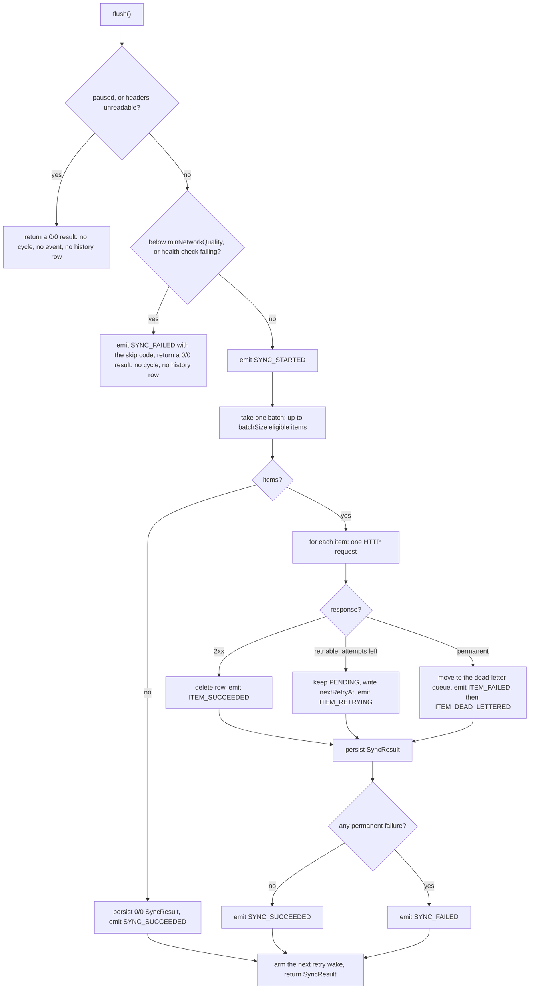
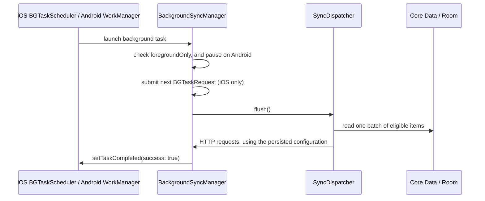
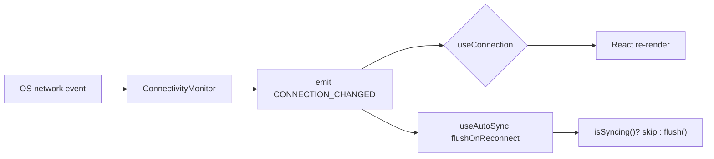
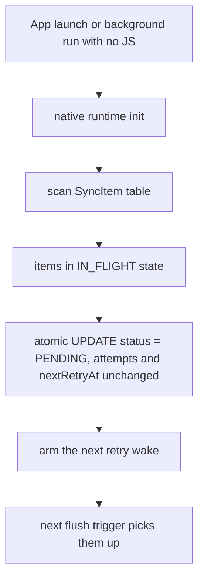

# Data Flow

Every major operation in `react-native-sync-provider` follows a predictable path through the three layers. This page traces the flows you'll need when debugging, building integrations, or contributing.

## High-Level Flow

## Enqueue Flow

Steps:

1. **Validate (JS)**. `validateSyncItem` ensures `method` is in [`HttpMethod`](../api-reference/enums.md#httpmethod) and `url` parses. Failures throw `SyncError` synchronously inside the awaited call.
2. **Cross JSI**. Nitro dispatches the `enqueue` call. The item object is passed through as a typed JS object -- no JSON marshalling.
3. **Check the cap (native)**. If the queue is at `maxQueueSize`, native rejects with `QUEUE_FULL`, which [reaches JS as `INVALID_PAYLOAD`](../api-reference/errors.md#native-rejections).
4. **Persist (native)**. The native `Ulid` / `ULID` utility produces a 26-character monotonic id, and the item is inserted into Core Data (iOS) or Room (Android) inside a transaction.
5. **Emit (native)**. `SyncEventEmitter` fires `ITEM_ENQUEUED` with the id.
6. **Resolve (JS)**. The promise resolves to the id.

Nothing is dispatched yet. A flush does that.

`enqueueBatch` follows the same flow but inside a single native transaction, so the entire batch is atomic.

## Foreground Flush Flow

Notes:

- A cycle takes **one batch** and makes **at most one attempt per item**. It does not loop: items left over wait for the next flush. Use [`drainUntilEmpty`](../api-reference/functions.md#drainuntilempty) to loop.
- "Eligible" means `PENDING` with `nextRetryAt <= now`, so cooling items are skipped. Priority orders the batch.
- Android sends a batch concurrently. iOS sends it one item at a time, and emits `SYNC_PROGRESS` once per item, before that item's `ITEM_*` event.
- The dispatcher checks connectivity only through the opt-in quality gate (`minNetworkQuality`), and the backend only through the opt-in health check (`healthCheckUrl`). Both are skipped when unset. See [Checks Before a Cycle](../api-reference/functions.md#checks-before-a-cycle).
- A permanent failure moves the item, in one transaction, from the queue to the dead-letter queue.
- Cycles do not overlap. On Android, a concurrent `flush()` waits for the running cycle and then runs its own. On iOS, it returns the last result at once.
- HTTP requests run on the native dispatcher's executor (`URLSession` on iOS, OkHttp + `Dispatchers.IO` on Android). The JS thread is never blocked.
- The `SyncResult` is persisted to history before the promise resolves.
- A cycle that dies emits `SYNC_FAILED` and rejects, so every cycle ends with a terminal event.

## Background Flush Flow

On both platforms, the flush runs the same checks as a foreground one, from the persisted configuration. See [When the gate or the health check skips a window](../guides/background-sync.md#when-the-gate-or-the-health-check-skips-a-window).

### Android (WorkManager)

WorkManager runs `SyncWorker`, at most every 15 minutes for the periodic job, and also for the opt-in retry kick. WorkManager enforces the constraints. The worker stays inert under `foregroundOnly` or a persisted pause. Otherwise, with no JS engine attached, it first resets rows a dead process left `IN_FLIGHT`. It then flushes and returns `Result.success()` on any completed flush, including one with failed items or one the quality gate or the health check skipped, so that WorkManager's backoff cannot race the persisted cooldowns. `Result.retry()` is reserved for a worker that fails as a whole.

### iOS (BGTaskScheduler)

`BGTaskScheduler` wakes a handler that was registered at process start. The handler re-submits the next request first, so the chain continues if the process is killed, then waits for launch recovery and flushes. It works with no JS loaded. A task that fires under `foregroundOnly` or after `disableBackgroundSync` completes inert. While paused, it completes without dispatching.

## Connectivity Change Flow

The native monitor is a singleton per process. An event is emitted only when a reported field of the snapshot changes, including `networkQuality` alone. Android never emits one for the state it starts in; iOS starts at `UNKNOWN`, so its first path report emits one. `useAutoSync` reads the starting status when it is enabled and compares each event's status with the last one it knows, so only a real change to `CONNECTED`, or to `METERED` with `flushOnMetered`, triggers its reconnect flush. A quality-only change never does.

The event does not start a native flush. `useAutoSync` does that from JS. Natively, a reconnect only delivers a wake the [retry timer](../guides/retry-policy.md#who-wakes-the-queue-and-when) owes from firing offline.

## Recovery Flow

Recovery handles the "process killed mid-dispatch" case. Without it, items would be stuck `IN_FLIGHT` forever. The reset is **transactional and idempotent** -- safe to run on every launch. It sends no request itself.

What starts it differs by platform.

### Android (RecoveryWorker)

`RecoveryWorker` runs when a JS engine attaches, and on boot and app update through `BootCompletedReceiver`. `SyncWorker` runs the same reset before it flushes when no JS engine is attached, unless a persisted pause or `foregroundOnly` blocks it. No event is emitted.

### iOS (RecoveryManager)

`RecoveryManager` runs on every engine start, including a BGTask launch with no JS. If it reset any item, it emits `RESUMED` with `metadata.recovered`.

## Next Steps

- [Architecture Overview](./overview.md) -- The three layers, the key design decisions and the technology stack
- [iOS Native Architecture](./ios-native.md) -- Swift modules, Core Data stack, BGTaskScheduler wiring
- [Android Native Architecture](./android-native.md) -- Kotlin modules, Room schema, WorkManager wiring
- [Background Sync](../guides/background-sync.md) -- Enabling background windows and what the OS decides
- [Crash Recovery](../guides/crash-recovery.md) -- What happens to queued and in-flight items after a crash, a reboot or an update
- [Connectivity Detection](../guides/connectivity-detection.md) -- Connection state, network quality and the health check
