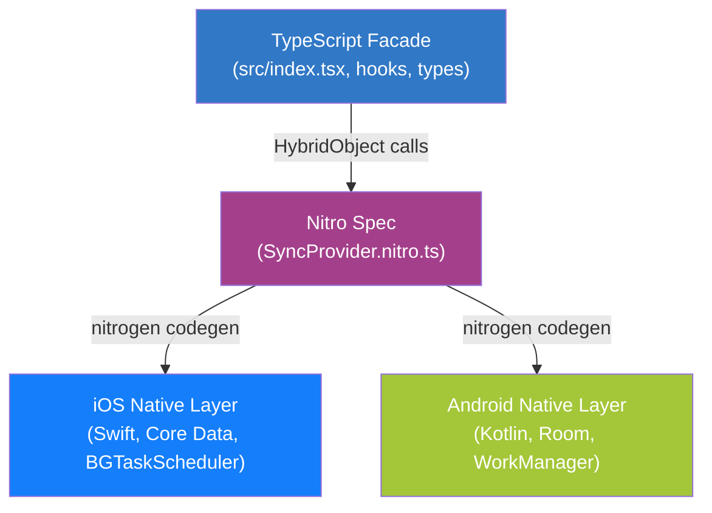

# Architecture Overview

`@gabriel-sisjr/react-native-sync-provider` is built on three layers that cooperate through a generated JSI bridge. The TypeScript facade is the only surface app code touches; the native layers do the heavy lifting (persistence, dispatch, scheduling).

## Three-Layer Design

### Layer 1: TypeScript Facade

Source of every public symbol: 24 functions (22 wrap the HybridObject, and `drainUntilEmpty` and `cancelDrain` are JS-side), 2 listener helpers, 9 hooks, the `SyncProvider` context, every type and enum, the `SyncError` class. Located under `src/`. Responsibilities:

- Validate inputs (`validateSyncItem`, and `validateSyncOptions` for the quality-gate and health-check options).
- Translate the native sentinel `startedAt === 0 && finishedAt === 0` for `getLastSyncResult` into `undefined`.
- Wrap raw native errors in [`SyncError`](../api-reference/errors.md) with a typed [`SyncErrorCode`](../api-reference/errors.md#syncerrorcode).
- Provide React hooks that subscribe to native events and re-render on relevant transitions.
- Degrade gracefully on web / SSR via `src/index.web.tsx` and `isNativeModuleAvailable`.

### Layer 2: Nitro Spec

`src/SyncProvider.nitro.ts` declares a `HybridObject<{ ios: 'swift'; android: 'kotlin' }>` interface. This is the source of truth for the JS↔native contract. Running `yarn nitrogen` produces:

- A C++ spec header per platform (`HybridSyncProviderSpec`).
- iOS autolinking ruby (`SyncProvider+autolinking.rb`) included by the podspec.
- Android autolinking gradle + cmake fragments included by `android/build.gradle` and `android/CMakeLists.txt`.
- The JNI loader stub (`syncproviderOnLoad.hpp`).

Generated artifacts live under `nitrogen/` and are not committed.

### Layer 3: Native Implementations

Each platform implements the spec using platform-idiomatic patterns:

| Concern | Android | iOS |
|---------|---------|-----|
| Language | Kotlin 2.0.21 by default, or the host's `kotlinVersion` | Swift 5.9+ |
| Persistence | Room (KSP, SQLite) | Core Data (SQLite) |
| HTTP dispatch | OkHttp 4.12.0 + Coroutines 1.8.1 | `URLSession` + `URLSessionConfiguration.background` |
| Connectivity | `ConnectivityManager.NetworkCallback` | `NWPathMonitor` (Network framework) |
| Background scheduler | WorkManager 2.9.1 (`PeriodicWorkRequest` + `OneTimeWorkRequest`) | `BGTaskScheduler` (`BGAppRefreshTaskRequest` + `BGProcessingTaskRequest`) |
| Recovery | `RecoveryWorker`, on JS attach, boot and app update; `SyncWorker`, before a flush with no JS engine attached | `RecoveryManager`, on every engine start, including a BGTask launch with no JS |
| Persisted configuration | SharedPreferences + Android Keystore | UserDefaults + Keychain |
| Retry wake | In-process timer + opt-in `WorkManager` kick | In-process timer |
| Event emission | `SyncEventEmitter` -> Nitro callback | `SyncEventEmitter` -> Nitro callback |

## Key Design Decisions

### Why Nitro and Not TurboModule

Nitro Modules cross the JSI boundary as **typed JS objects** -- no JSON `parse` / `stringify` step, no enum-to-string mapping. For a sync queue that may shuttle hundreds of items between JS and native every second, that matters:

- Object payloads (`SyncItem`, `SyncEvent`) are dispatched as native objects, not JSON.
- Enum values are passed through as-is.
- Async functions return `Promise`s without bridge serialization.

The New Architecture is required: the library is built and tested only on it. Nitro itself can install on the legacy bridge, but this library is not tested there.

### A Native Engine That Runs Without JS

The sync engine lives in native code, so a background run needs no JS. On iOS, `SyncEngine.shared` owns the queue, the dispatcher, the retry timer and the configuration, and is built on first use by JS creating the hybrid or by a fired BGTask. On Android, `SyncProviderRuntime` is the process-wide container that WorkManager workers share, and it restores the persisted configuration whichever process builds it. See [iOS Native Architecture](./ios-native.md#syncengine) and [Android Native Architecture](./android-native.md#directory-map).

### Configuration Persisted for Background Runs

`configureSync` persists its options, so a worker or BGTask in a process the app never spoke to honors them. `defaultHeaders` are encrypted at rest, with an Android Keystore key and in the iOS Keychain, and a call without them deletes the stored copy. The library does not refresh tokens. See [Cold-start configuration](../guides/background-sync.md#cold-start-configuration).

### At-Least-Once Delivery

A request can reach the server more than once: a process that dies mid-request leaves its item `IN_FLIGHT`, launch recovery puts it back to `PENDING`, and the next cycle sends it again. Endpoints that receive queued requests must be [idempotent](../guides/idempotency.md).

### Opt-In Network Checks

The dispatcher checks connectivity only through the quality gate (`minNetworkQuality`) and the backend only through the health check (`healthCheckUrl`), and both are off until set. When set, they run before every cycle, after the pause and stored-credentials checks, the gate first. A cycle they skip changes no item and spends no attempt. See [The quality gate](../guides/connectivity-detection.md#the-quality-gate).

### Graceful Degradation on Web and SSR

`src/utils/isNativeModuleAvailable.ts` creates the HybridObject lazily, at most once per process, so importing the package never fails where Nitro is not loaded. The web entry, `src/index.web.tsx`, exports the same names: its functions throw `NATIVE_MODULE_UNAVAILABLE` and its hooks return inert state. `cancelDrain` and the listener helpers are the exceptions: they do nothing, because they sit in cleanup paths.

### Handler Registration at Process Start (iOS)

The library registers its BGTask handlers from `+load`, which runs before `didFinishLaunchingWithOptions` returns, so the app's `AppDelegate` needs no registration code. It registers only the identifiers the app declares in `BGTaskSchedulerPermittedIdentifiers`, because registering any other traps. Both identifiers are fixed. See [BackgroundSyncManager](./ios-native.md#backgroundsyncmanager-bgtaskscheduler).

### No Foreground Service (Android)

The library declares no foreground service. WorkManager and `BootCompletedReceiver` are sufficient for an offline-first HTTP queue, so the app shows no user-facing notification on the library's behalf. See [Android Permissions](../production/android-permissions.md).

## Technology Stack

| Component | Technology | Rationale |
|-----------|-----------|-----------|
| JS/TS layer | TypeScript, React | Typed public API; hooks that re-render on native events |
| Bridge | Nitro Modules + `nitrogen` codegen | Typed objects across JSI with no JSON step; one spec generates both native bases |
| Android module | Kotlin 2.0.21 by default, or the host's `kotlinVersion` | Coroutines for the dispatcher, the workers and the connectivity flow |
| Android persistence | Room 2.7.0 (KSP, SQLite) | The floor whose KSP processor works with Kotlin 2.0.x; exported, versioned schemas |
| Android HTTP | OkHttp 4.12.0 | One shared client for every cycle |
| Android concurrency | Kotlin Coroutines 1.8.1 | `supervisorScope`, so one failed item never cancels a cycle |
| Android background | WorkManager 2.9.1 | Periodic work, and a retry kick that survives process death |
| Android secrets | Android Keystore | AES-256-GCM under a non-exportable key for `defaultHeaders` |
| iOS module | Swift | Actors and `async` `URLSession` calls in the dispatcher |
| iOS persistence | Core Data (SQLite) | Versioned model that migrates an older store into a side file, then swaps it in with `replacePersistentStore` |
| iOS HTTP | `URLSession` (foreground and background sessions) | The background session lets the OS finish an upload while the app is suspended |
| iOS background | `BGTaskScheduler` | App-refresh and processing windows that need no JS |
| iOS secrets | Keychain | `defaultHeaders`, readable after first unlock, on this device only |
| Build system | react-native-builder-bob | Runs `nitrogen`, then emits ESM modules and TypeScript declarations |
| Monorepo | Yarn 4.11.0 workspaces + Turborepo | Library, example app and docs site in one repo; cached native example builds |

## Key Data Structures

The native layer is built around four immutable record types:

| Type | Owner | Purpose |
|------|-------|---------|
| [`SyncItem`](../api-reference/types.md#syncitem) | Queue storage | The persisted row: id, method, url, headers, body, contentType, priority, createdAt, attempts, nextRetryAt, metadata. |
| [`SyncDeadLetterItem`](../api-reference/types.md#syncdeadletteritem) | Dead-letter storage | An item that failed permanently: the request, plus attempts, lastAttemptAt, lastErrorCode, lastErrorMessage and deadLetteredAt. |
| [`SyncResult`](../api-reference/types.md#syncresult) | History storage | A completed flush: counts, timing, and a per-item success / failure breakdown with an error map, filled on Android only. |
| [`SyncEvent`](../api-reference/types.md#syncevent) | Event emitter | A single broadcast on the [`SYNC_EVENT_CHANNEL`](../api-reference/listeners.md). |

These shapes are identical on both platforms -- the spec defines them once and both Swift and Kotlin implementations marshal to / from the same JS shape.

## Cross-Cutting Concerns

### Event System

Both platforms emit on the same channel string (`'sync-event'`) with the same payload shape. The 16 [`SyncEventType`](../api-reference/enums.md#synceventtype) values are the canonical set. Hooks like `useSyncQueue`, `useSyncStatus`, and `useConnection` are thin subscribers around this stream.

### Persistence and Recovery

Both platforms persist:

- The pending queue (Core Data `SyncItem` entity / Room `SyncItemEntity`).
- The dead letters (Core Data `SyncDeadLetterEntity` / Room `SyncDeadLetterEntity`).
- The sync history (Core Data `SyncResult` entity / Room `SyncResultEntity`).
- The current configuration (last applied `SyncOptions`), so a process with no JS honors it. `defaultHeaders` are encrypted at rest. See [Cold-start configuration](../guides/background-sync.md#cold-start-configuration).

The recovery layer scans for items left in an `IN_FLIGHT` state by a previous run (process killed mid-dispatch) and atomically resets them to `PENDING`. It runs on launch, and before a flush in a background run with no JS: an iOS BGTask or an Android worker. A persisted pause or `foregroundOnly` blocks the Android worker, recovery included. The [recovery flow](./data-flow.md#recovery-flow) lists each platform's triggers. Delivery is therefore at least once, and endpoints must be [idempotent](../guides/idempotency.md).

### Connectivity Monitoring

A single native monitor per process (`ConnectivityMonitor`) emits `CONNECTION_CHANGED` events, only when a reported field changes, and grades the link with a [`networkQuality`](../guides/connectivity-detection.md#network-quality) level. The JS layer consumes them via `useConnection` and `useAutoSync`, and the retry timer uses the monitor to hold a wake while offline or below `minNetworkQuality`. The dispatcher checks connectivity only through that opt-in quality gate, at the start of every flush, before the opt-in health check.

## Performance Notes

- The bridge is **Nitro Modules**, not TurboModules. Object payloads (e.g. `SyncItem`) cross the JSI boundary as native objects — no JSON `parse`/`stringify` tax.
- The native dispatcher runs off the JS thread. Hooks subscribe via Nitro callbacks.
- Default batch size is `25`. Tunable via `configureSync({ batchSize })`. Android sends a batch concurrently, except that with `defaultHeaders` restored from disk the first item goes out alone first. iOS sends one item at a time.
- Background dispatch on iOS uses `URLSessionConfiguration.background` when the app is not active, unless `foregroundOnly` is set, so the OS may finish an upload while the app is suspended.

## Next Steps

- [Data Flow](./data-flow.md) -- Step-by-step traces of every major operation
- [iOS Native Architecture](./ios-native.md) -- Swift modules, Core Data stack, BGTaskScheduler wiring
- [Android Native Architecture](./android-native.md) -- Kotlin modules, Room schema, WorkManager wiring
